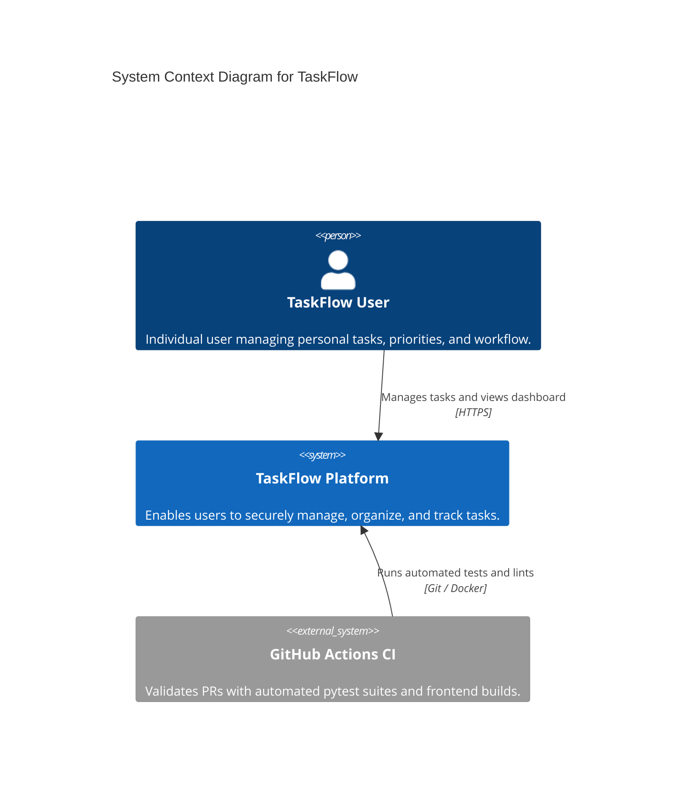
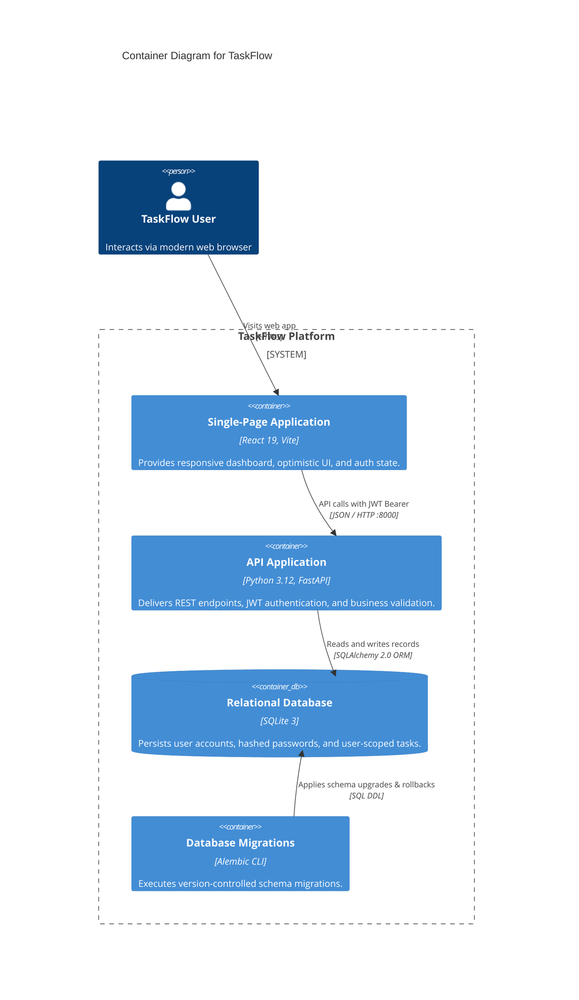

# TaskFlow — System Architecture Documentation

## 1. System Overview

TaskFlow is a full-stack, modular task orchestration and management platform developed across a 7-day iterative engineering plan. The system is designed for high performance, developer productivity, type safety, and clean separation of concerns.

### 1.1 C4 Level 1: System Context Diagram

The System Context diagram provides a high-level view of TaskFlow, showing its system boundaries, users, and external integrations.



### 1.2 C4 Level 2: Container Diagram

The Container diagram zooms into the TaskFlow platform to illustrate the deployable software units, their responsibilities, and protocols.



---

## 2. System Requirements & Planning Assumptions

### 2.1 Explicit Planning Assumptions
* **Target Scale (v1 MVP)**: Designed for single-tenant or small team deployment with ~1,000 registered users and ~50 concurrent active users.
* **Traffic Pattern**: Estimated read-heavy distribution: **80% reads** (viewing tasks, polling dashboard) vs. **20% writes** (creating, updating, deleting tasks).
* **Payload Profiles**: Standard JSON request/response payloads are small (typically < 10 KB).
* **Compute Baseline**: Local development and CI runners with 2 vCPUs and 4 GB RAM.

### 2.2 Functional Requirements (FRs)
* **FR-1: Authentication & User Accounts**
  * Users can register with an email and password.
  * Users can authenticate to obtain a time-limited JSON Web Token (JWT).
  * Users can query their own authenticated profile (`GET /api/v1/auth/me`).
* **FR-2: Task CRUD Operations**
  * Authenticated users can create, read, update, and delete tasks.
  * Each task contains: `id`, `title` (max 255 chars), `description` (optional text), `status` (`todo`, `in_progress`, `done`), `priority` (`low`, `medium`, `high`), `due_date` (ISO-8601 UTC timestamp), `created_at`, `updated_at`, and `user_id`.
* **FR-3: Data Isolation & Ownership**
  * All task queries are strictly scoped to the authenticated `user_id`.
  * Users cannot view, modify, or delete tasks belonging to other users.
* **FR-4: Search, Filtering & Pagination**
  * Task listing supports filtering by `status` and `priority`.
  * Task listing supports keyword search across `title` and `description`.
  * Task listing enforces query pagination (`limit` default 20, max 100; `offset`) and returns total count metadata.
* **FR-5: Health & Observability**
  * The system exposes an unauthenticated health probe (`GET /health`) reporting service status, database connectivity, and API version.

### 2.3 Non-Functional Requirements (NFRs)
* **NFR-1: Latency (Response Times)**
  * **Read Latency**: 95% of task listing and retrieval requests (`GET /api/v1/tasks`, `GET /api/v1/tasks/{id}`) must complete within **≤ 50ms** locally (SQLite embedded) and **≤ 150ms** in containerized environments.
  * **Write Latency**: 95% of task mutation requests (`POST`, `PUT`, `DELETE`) must complete within **≤ 100ms**.
  * *(Exception: Password hashing via bcrypt during login/register is intentionally CPU-bound at ~100–250ms for cryptographic security against brute-force attacks).*
* **NFR-2: Throughput**
  * The backend must sustain at least **100 Requests Per Second (RPS)** under normal conditions without errors exceeding 0.1%.
* **NFR-3: Availability & Reliability**
  * **Target Availability**: 99.5% uptime during prototype/staging phases (allowing scheduled maintenance during development).
  * Health check endpoint (`GET /health`) response time must be **≤ 10ms**.
* **NFR-4: Security & Authentication**
  * Passwords must be hashed using `bcrypt` (cost factor 12) before persistence; plaintext passwords must never appear in logs or database tables.
  * API endpoints (except `/`, `/health`, and `/api/v1/auth/*`) require a valid Bearer JWT.
  * Access tokens expire in 60 minutes.
  * CORS is restricted to explicit origins via environment variables.
* **NFR-5: Data Integrity & Consistency**
  * Strong ACID consistency: Relational transactions guarantee that once a task is written or updated, immediate subsequent reads reflect that state.
  * Foreign key constraints enforced: Deleting a user cascades or prevents orphaned task records.
* **NFR-6: Maintainability & Code Quality**
  * Layered modular architecture separating routers, schemas, services, and models.
  * Automated test coverage ≥ 80% for backend core route handlers and domain logic.
  * Automated CI pipeline must pass linting and unit tests on every pull request.

---

## 3. Technology Stack

| Layer | Technology | Version | Purpose |
| :--- | :--- | :--- | :--- |
| **Backend API** | Python / FastAPI | 3.12 / 0.153+ | High-performance asynchronous REST API framework |
| **ORM & DB Access** | SQLAlchemy | 2.0+ | Type-safe SQL database abstraction and query building |
| **Schema Migrations**| Alembic | 1.20+ | Declarative and repeatable database schema evolution |
| **Backend Testing** | Pytest / HTTPX | 9.1+ / 0.28+ | Automated unit, endpoint, and integration test suite |
| **Frontend UI** | React / Vite | 19 / 8.3+ | Component-driven user interface with ultra-fast HMR |
| **Database** | SQLite 3 | Embedded | Zero-configuration relational database with WAL support |
| **Containerization**| Docker Compose | v2+ | Unified local multi-service container orchestration |
| **Continuous Integration** | GitHub Actions | Standard | Automated testing and build verification on push / PR |

---

## 4. Backend Architecture

The backend follows an idiomatic, layered architecture:

```
backend/
├── app/
│   ├── main.py          # FastAPI application entrypoint, CORS & middleware
│   ├── database.py      # SQLAlchemy engine, session maker, Base, and session dependency
│   ├── models/          # (Day 1+) SQLAlchemy ORM models
│   ├── schemas/         # (Day 1+) Pydantic request/response validation schemas
│   ├── routers/         # (Day 2+) Modular API route handlers
│   └── services/        # (Day 2+) Domain business logic & data operations
├── migrations/          # Alembic migration scripts and version tracking
│   ├── env.py           # Migration environment context configuration
│   └── versions/        # Version revision files
├── tests/               # Pytest suite
│   ├── __init__.py
│   └── test_health.py   # Health endpoint & root route test suite
├── alembic.ini          # Alembic configuration
└── requirements.txt     # Python package dependencies
```

### Key Principles
1. **Dependency Injection**: Database sessions (`get_db`) and authentication are injected via FastAPI dependencies.
2. **Environment Configuration**: Runtime settings are read from environment variables with sensible development defaults.
3. **CORS Security**: Cross-Origin Resource Sharing is controlled via `CORS_ORIGINS`.

---

## 5. Frontend Architecture

The frontend is a single-page application built on React 19 and Vite:

```
frontend/
├── index.html           # HTML entry point with metadata and fonts
├── vite.config.js       # Vite build & plugin configuration
├── package.json         # Scripts and NPM dependencies
└── src/
    ├── main.jsx         # React root mounting
    ├── App.jsx          # Root dashboard, telemetry inspector, and task manager
    ├── App.css          # Component layout, card styles, and animations
    ├── index.css        # Core design system tokens, typography, and theme
    └── assets/          # Static icons and imagery
```

### Key Principles
- **Modern Design System**: CSS variables provide unified color palettes, spacing, and glassmorphic elevation without heavy external UI dependencies.
- **Resilient Network Handling**: Configurable API endpoints (`VITE_API_URL`) with graceful connection failure handling and latency telemetry.

---

## 6. Database Strategy & Migrations

- **Engine**: SQLite is selected for initial development simplicity, zero network overhead, and portability across local and CI environments.
- **Concurrency**: `check_same_thread=False` is enabled in `database.py` for multithreaded request handling in FastAPI.
- **Migrations**: Alembic tracks schema changes in `migrations/versions/`. Migrations can be applied using:
  ```bash
  alembic upgrade head
  ```

---

## 7. Docker & Container Strategy

- **Backend Container**: Python 3.12 slim base image, non-root user execution, port 8000 exposed with healthcheck.
- **Frontend Container**: Multi-stage build (Node build -> Nginx or lightweight preview server), port 5173/80 exposed.
- **Docker Compose**: Orchestrates both services with volume mounts for live reload during development.

---

## 8. 7-Day Sprint Roadmap

- **Day 0**: Repository and environment setup, baseline health endpoints, CI pipeline, Docker configuration, and documentation templates.
- **Day 1**: User models, password hashing, and authentication endpoints.
- **Day 2**: Task models, CRUD endpoints, and Alembic migrations.
- **Day 3**: Frontend UI components, auth state management, and task dashboard.
- **Day 4**: Advanced filtering, search, sorting, and optimistic UI updates.
- **Day 5**: Automated test coverage, integration tests, and security hardening.
- **Day 6**: Container optimization, production builds, and CI/CD validation.
- **Day 7**: Retrospective, performance benchmarking, and final release review.
