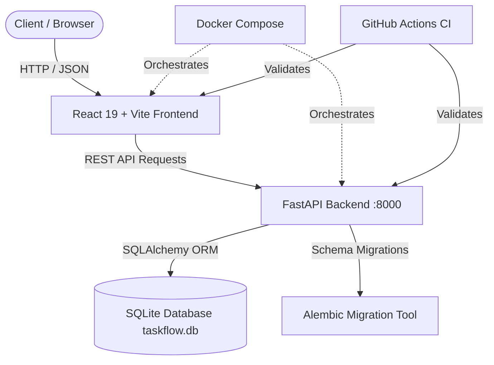

# TaskFlow — System Architecture Documentation

## 1. System Overview

TaskFlow is a full-stack, modular task orchestration and management platform developed across a 7-day iterative engineering plan. The system is designed for high performance, developer productivity, type safety, and clean separation of concerns.



---

## 2. Technology Stack

| Layer | Technology | Version | Purpose |
| :--- | :--- | :--- | :--- |
| **Backend API** | Python / FastAPI | 3.12 / 0.153+ | High-performance asynchronous REST API framework |
| **ORM & DB Access** | SQLAlchemy | 2.0+ | Type-safe SQL database abstraction and query building |
| **Schema Migrations**| Alembic | 1.20+ | Declarative and repeatable database schema evolution |
| **Backend Testing** | Pytest / HTTPX | 9.1+ / 0.28+ | Automated unit, endpoint, and integration test suite |
| **Frontend UI** | React / Vite | 19 / 8.3+ | Component-driven user interface with ultra-fast HMR |
| **Database** | SQLite 3 | Embedded | Zero-configuration relational database with WAL support |
| **Containerization**| Docker Compose | v2+ | Unified local multi-service container orchestration |
| **Continuous Integration** | GitHub Actions | Standard | Automated testing and build verification on push / PR |

---

## 3. Backend Architecture

The backend follows an idiomatic, layered architecture:

```
backend/
├── app/
│   ├── main.py          # FastAPI application entrypoint, CORS & middleware
│   ├── database.py      # SQLAlchemy engine, session maker, Base, and session dependency
│   ├── models/          # (Day 1+) SQLAlchemy ORM models
│   ├── schemas/         # (Day 1+) Pydantic request/response validation schemas
│   ├── routers/         # (Day 2+) Modular API route handlers
│   └── services/        # (Day 2+) Domain business logic & data operations
├── migrations/          # Alembic migration scripts and version tracking
│   ├── env.py           # Migration environment context configuration
│   └── versions/        # Version revision files
├── tests/               # Pytest suite
│   ├── __init__.py
│   └── test_health.py   # Health endpoint & root route test suite
├── alembic.ini          # Alembic configuration
└── requirements.txt     # Python package dependencies
```

### Key Principles
1. **Dependency Injection**: Database sessions (`get_db`) and authentication are injected via FastAPI dependencies.
2. **Environment Configuration**: Runtime settings are read from environment variables with sensible development defaults.
3. **CORS Security**: Cross-Origin Resource Sharing is controlled via `CORS_ORIGINS`.

---

## 4. Frontend Architecture

The frontend is a single-page application built on React 19 and Vite:

```
frontend/
├── index.html           # HTML entry point with metadata and fonts
├── vite.config.js       # Vite build & plugin configuration
├── package.json         # Scripts and NPM dependencies
└── src/
    ├── main.jsx         # React root mounting
    ├── App.jsx          # Root dashboard, telemetry inspector, and task manager
    ├── App.css          # Component layout, card styles, and animations
    ├── index.css        # Core design system tokens, typography, and theme
    └── assets/          # Static icons and imagery
```

### Key Principles
- **Modern Design System**: CSS variables provide unified color palettes, spacing, and glassmorphic elevation without heavy external UI dependencies.
- **Resilient Network Handling**: Configurable API endpoints (`VITE_API_URL`) with graceful connection failure handling and latency telemetry.

---

## 5. Database Strategy & Migrations

- **Engine**: SQLite is selected for initial development simplicity, zero network overhead, and portability across local and CI environments.
- **Concurrency**: `check_same_thread=False` is enabled in `database.py` for multithreaded request handling in FastAPI.
- **Migrations**: Alembic tracks schema changes in `migrations/versions/`. Migrations can be applied using:
  ```bash
  alembic upgrade head
  ```

---

## 6. Docker & Container Strategy

- **Backend Container**: Python 3.12 slim base image, non-root user execution, port 8000 exposed with healthcheck.
- **Frontend Container**: Multi-stage build (Node build -> Nginx or lightweight preview server), port 5173/80 exposed.
- **Docker Compose**: Orchestrates both services with volume mounts for live reload during development.

---

## 7. 7-Day Sprint Roadmap

- **Day 0**: Repository and environment setup, baseline health endpoints, CI pipeline, Docker configuration, and documentation templates.
- **Day 1**: User models, password hashing, and authentication endpoints.
- **Day 2**: Task models, CRUD endpoints, and Alembic migrations.
- **Day 3**: Frontend UI components, auth state management, and task dashboard.
- **Day 4**: Advanced filtering, search, sorting, and optimistic UI updates.
- **Day 5**: Automated test coverage, integration tests, and security hardening.
- **Day 6**: Container optimization, production builds, and CI/CD validation.
- **Day 7**: Retrospective, performance benchmarking, and final release review.
