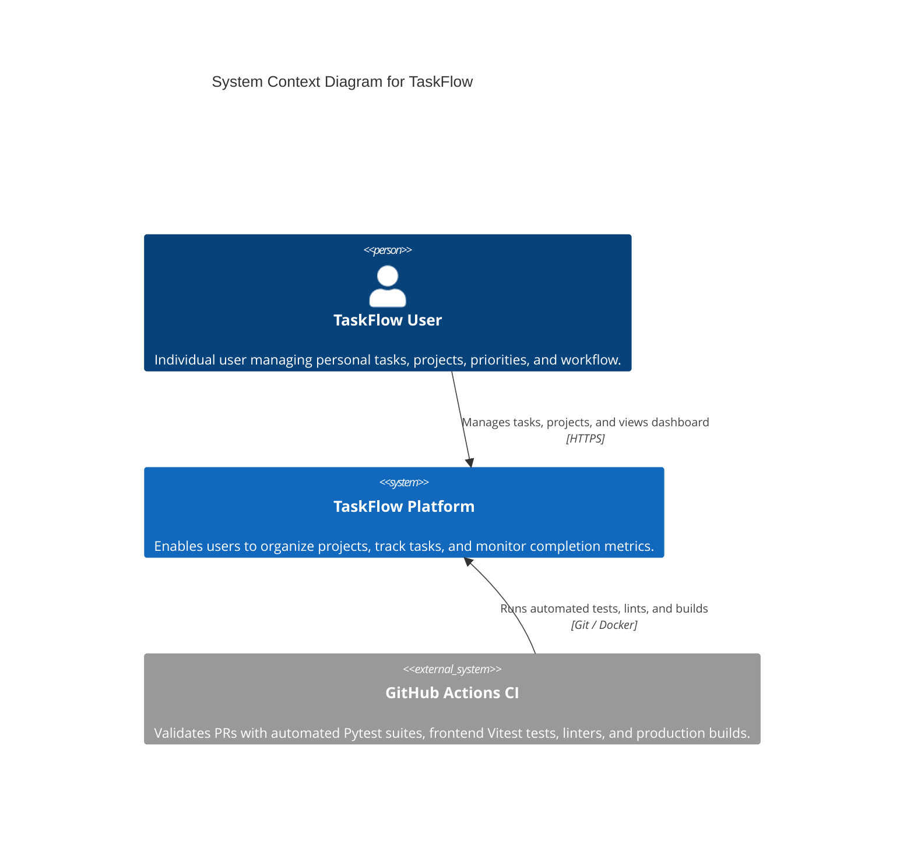
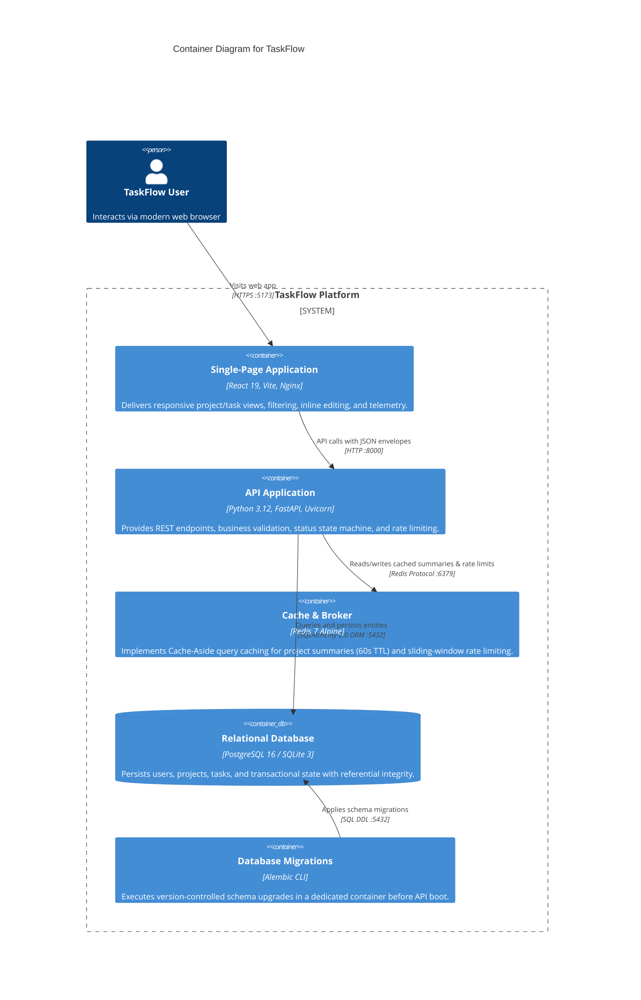

# TaskFlow — System Architecture Documentation

## 1. System Overview

TaskFlow is a full-stack, modular task orchestration and management platform developed across a 7-day iterative engineering plan. The system is designed for high performance, developer productivity, type safety, and clean separation of concerns.

### 1.1 C4 Level 1: System Context Diagram

The System Context diagram provides a high-level view of TaskFlow, showing its system boundaries, users, and external integrations.



### 1.2 C4 Level 2: Container Diagram

The Container diagram illustrates the deployable software units, their responsibilities, and protocols.



---

## 2. System Requirements & Planning Assumptions

### 2.1 Explicit Planning Assumptions
* **Target Scale (v1 MVP)**: Designed for single-tenant or small team deployment with ~1,000 registered users and ~50 concurrent active users.
* **Traffic Pattern**: Estimated read-heavy distribution: **80% reads** (viewing tasks, project summaries, polling dashboard) vs. **20% writes** (creating, updating, deleting tasks).
* **Payload Profiles**: Standard JSON request/response payloads are small (typically < 10 KB).
* **Compute Baseline**: Local development and CI runners with 2 vCPUs and 4 GB RAM.

### 2.2 Functional Requirements (FRs)
* **FR-1: Authentication & User Accounts**
  * Users can register with email and password (`POST /api/v1/auth/register`).
  * Users can authenticate to obtain a Bearer JWT (`POST /api/v1/auth/login`).
  * Users can query their own profile (`GET /api/v1/auth/me`).
* **FR-2: Project Management**
  * Users can create projects (`POST /api/v1/projects`) and list paginated projects (`GET /api/v1/projects`).
  * Projects support partial updates (`PATCH /api/v1/projects/{id}`).
  * Project summaries return aggregated task status counts with Cache-Aside acceleration (`GET /api/v1/projects/{id}/summary`).
* **FR-3: Task CRUD & Lifecycle Operations**
  * Users can create, read, update, and delete tasks (`/api/v1/tasks`).
  * Task status transitions enforce a valid state machine (`todo <-> in_progress <-> done`).
  * Creation supports optional due dates with background reminder dispatch.
* **FR-4: Search, Filtering & Pagination**
  * Task listing supports filtering by `status`, `priority`, and `project_id`.
  * Task listing supports substring search across `title` and `description`.
  * Listing enforces `limit` (default 20, max 100) and `offset` pagination returning total count metadata.
* **FR-5: Health & Observability**
  * System exposes unauthenticated process liveness (`GET /health`) and active database readiness (`GET /ready`).
  * Request-ID middleware injects `X-Request-ID` headers and correlates structured JSON logs.

### 2.3 Non-Functional Requirements (NFRs)
* **NFR-1: Latency (Response Times)**
  * **Read Latency**: 95% of task and project listing requests complete within **≤ 50ms** locally (SQLite) and **≤ 150ms** in containerized environments.
  * **Cached Queries**: Project summary queries served from Redis cache complete within **≤ 15ms**.
  * **Write Latency**: 95% of mutation requests (`POST`, `PUT`, `DELETE`) complete within **≤ 100ms**.
* **NFR-2: Rate Limiting & Resilience**
  * Task creation is rate limited to 30 requests/minute per client IP to mitigate spam and resource starvation.
  * Database operations feature transaction rollbacks on integrity violations.
* **NFR-3: Error Handling & Standards**
  * All non-2xx HTTP responses adhere to RFC 9457 (`application/problem+json`) with standard `type`, `title`, `status`, `detail`, and optional `invalid_params`.

---

## 3. Technology Stack

| Layer | Technology | Version | Purpose |
| :--- | :--- | :--- | :--- |
| **Backend API** | Python / FastAPI | 3.12 / 0.153+ | High-performance asynchronous REST API framework |
| **Configuration** | Pydantic Settings | 2.0+ | Centralized, validated environment configuration with `.env` support |
| **ORM & DB Access** | SQLAlchemy | 2.0+ | Type-safe SQL database abstraction and dialect-neutral models |
| **Schema Migrations**| Alembic | 1.20+ | Declarative and reversible database schema evolution |
| **Caching & Rate Limit**| Redis | 7-alpine | In-memory Cache-Aside store and rate limiter backend |
| **Backend Testing** | Pytest / HTTPX | 9.1+ / 0.28+ | Automated unit, service, integration, and coverage test suite |
| **Frontend UI** | React / Vite | 19 / 8.3+ | Component-driven user interface with CSS variable tokens |
| **Frontend Testing** | Vitest / RTL | 5.0+ / 16.3+ | Component integration testing and API client unit tests |
| **Database** | PostgreSQL / SQLite | 16 / 3.x | PostgreSQL for production/Docker; SQLite for lightweight local testing |
| **Web Server** | Nginx | 1.27-alpine | Production SPA web server with immutable asset caching |
| **Containerization**| Docker Compose | v2+ | Multi-service orchestration (`postgres`, `redis`, `migration`, `api`, `web`) |
| **CI / Quality** | GitHub Actions / Ruff / Oxlint | Pinned | Multi-job workflow enforcing lint, format, type, test, and build |

---

## 4. Backend Architecture

The backend follows an idiomatic, layered architecture isolating transport, validation, business domain logic, and data access:

```
backend/
├── app/
│   ├── main.py              # FastAPI application entrypoint, CORS & route mounting
│   ├── config.py            # Pydantic Settings centralization (.env, env vars)
│   ├── database.py          # SQLAlchemy engine, SessionLocal, Base, get_db dependency
│   ├── cache.py             # Redis client, Cache-Aside service, summary invalidation
│   ├── rate_limiter.py      # Sliding-window rate limiting dependency (30 req/min)
│   ├── middleware.py        # Request-ID tracking (X-Request-ID) & JSON structured logging
│   ├── models/              # SQLAlchemy ORM entity definitions
│   │   ├── user.py          # User account entity (email, password hash)
│   │   ├── project.py       # Project entity (owner FK, name, description)
│   │   └── task.py          # Task entity (status/priority checks, user/project FKs)
│   ├── schemas/             # Pydantic request/response validation contracts
│   │   ├── user.py          # User registration, login, and response schemas
│   │   ├── project.py       # Project create, update, list, and summary schemas
│   │   └── task.py          # Task create, update, list, and response schemas
│   ├── routers/             # HTTP route handlers (thin controllers)
│   │   ├── auth.py          # Registration, login, /me endpoints
│   │   ├── projects.py      # Project CRUD, summary, and nested task creation
│   │   └── tasks.py         # Task CRUD, filters, pagination, reminders
│   └── services/            # Domain business logic isolated from HTTP transport
│       └── task_service.py  # Status transition state machine, task queries, validation
├── migrations/              # Alembic migration scripts and version tracking
│   ├── env.py               # Migration environment context configuration
│   └── versions/            # Reversible migration revision scripts
├── tests/                   # Automated Pytest suite
│   ├── conftest.py          # Test fixtures, database isolation, mock cache
│   ├── test_health.py       # Health and readiness endpoint tests
│   ├── test_task_service.py # Domain unit tests for status transition state machine
│   ├── test_tasks.py        # Task REST API endpoint integration tests
│   ├── test_projects.py     # Project REST API & summary integration tests
│   ├── test_cache.py        # Cache-Aside and eviction integration tests
│   ├── test_rate_limiter.py # Rate limiter enforcement tests
│   ├── test_observability.py# Request-ID and JSON logging tests
│   └── test_database_compatibility.py # SQLite and PostgreSQL dialect validation
├── alembic.ini              # Alembic migration configuration
├── Dockerfile               # Multi-stage Python 3.12-slim production container
└── requirements.txt         # Pinned Python package dependencies
```

### Key Principles & Patterns
1. **Separation of Concerns**: HTTP handlers in `routers/` validate inputs via Pydantic and delegate execution to `services/task_service.py`. Database models in `models/` define constraints without HTTP dependencies.
2. **Status Transition State Machine**: Valid status transitions (`todo <-> in_progress <-> done`) are strictly enforced in `TaskService`. Invalid transitions raise domain exceptions mapped to HTTP 400 with RFC 9457 error payloads.
3. **Cache-Aside Pattern**: Project summaries (`GET /api/v1/projects/{id}/summary`) first query Redis. On cache miss, aggregated counts are computed via database query and cached with a 60-second TTL. Any task mutation within the project automatically evicts the cache entry.
4. **Structured JSON Logging**: Every incoming request is assigned a UUID `X-Request-ID`. Logs output machine-parseable JSON containing timestamp, level, method, path, status, latency, and client IP.
5. **Type-Safe Configuration**: Pydantic Settings (`app.config.Settings`) centralizes all environment variables (`DATABASE_URL`, `REDIS_URL`, `CORS_ORIGINS`, `TRUSTED_PROXIES`, `LOG_LEVEL`), providing fail-fast validation on startup and memoized access via `get_settings()` dependency injection.

---

## 5. Frontend Architecture

The frontend is a modern single-page application built with React 19 and Vite 8:

```
frontend/
├── index.html               # HTML entry point with modern typography
├── package.json             # NPM package scripts & pinned dependencies
├── vite.config.js           # Vite build configuration with Vitest setup
├── nginx.conf               # Nginx reverse proxy & SPA fallback configuration
├── Dockerfile               # Multi-stage container (Node 22 builder -> Nginx runner)
└── src/
    ├── main.jsx             # React DOM root mounting
    ├── api.js               # Centralized API client module with RFC 9457 error parsing
    ├── App.jsx              # Main orchestrator (projects, detail view, task list, filters)
    ├── App.css              # Component layout, card styles, and animations
    ├── index.css            # Design system tokens, dark theme, and typography
    ├── api.test.js          # API client unit test suite (11 tests)
    └── App.test.jsx         # React Testing Library integration test suite (13 tests)
```

### Key Components & State Flow
1. **API Client (`api.js`)**: Encapsulates `fetch` calls, handles URL query serialization, and uniformly parses RFC 9457 Problem Details (`detail` or `title` attributes) while gracefully handling HTTP 204 No Content.
2. **Projects Column**: Lists projects from `GET /api/v1/projects` with loading state, error retry banner, empty state, and active project selection.
3. **Project Detail & Telemetry**: Displays selected project title, description, and status metrics (`total_tasks`, `todo`, `in_progress`, `done`) fetched from `GET /api/v1/projects/{id}/summary`.
4. **Task Lifecycle Management**:
   - **Creation**: Form with title, priority (`low`, `medium`, `high`), and status (`todo`, `in_progress`, `done`), backed by client validation.
   - **Status Transitions**: Checkbox toggle (`todo <-> done`) and status selector dropdown for direct lifecycle progression.
   - **Inline Editing**: Inline form to modify task title, priority, and status with Save and Cancel controls.
   - **Deletion**: Immediate removal via `DELETE /api/v1/tasks/{id}` with automatic summary count refresh.
5. **Reactive Filters**: Dropdown filters for status and priority, combined with live text search matching title and description.

---

## 6. Database Strategy & Migrations

- **Dual-Dialect Support**: Models utilize dialect-neutral SQLAlchemy types (`String`, `DateTime`, `Uuid`, `CheckConstraint`) supported seamlessly across PostgreSQL (production/docker) and SQLite (testing/local development).
- **Concurrency & WAL Mode**: SQLite runs with `check_same_thread=False` for concurrent local development. PostgreSQL in Docker Compose handles production concurrent transactions.
- **Dedicated Migration Service**: `docker-compose.yml` runs migrations via a dedicated, one-off container (`migration`) that exits before API replicas boot, preventing concurrent migration race conditions.

---

## 7. Containerization & Production Strategy

- **Backend Container (`backend/Dockerfile`)**:
  - Multi-stage build based on `python:3.12-slim`.
  - Isolate build dependencies in builder stage; copies only `/opt/venv` to final runner.
  - Runs under unprivileged system user `taskflow` (`uid: 10001`).
- **Frontend Container (`frontend/Dockerfile`)**:
  - Multi-stage build based on `node:22-alpine` compiling static assets via `npm run build`.
  - Production runner uses `nginx:1.27-alpine` serving static assets with gzip compression, SPA fallback routing (`try_files $uri /index.html`), and immutable cache headers.
- **Docker Compose Stack (`docker-compose.yml`)**:
  - `postgres`: PostgreSQL 16 on port 5432 with health check and persistent volume.
  - `redis`: Redis 7 on port 6379 with health check and persistent volume.
  - `migration`: Dedicated migration runner (`alembic upgrade head`).
  - `api`: FastAPI application dependent on healthy postgres, redis, and finished migrations.
  - `web`: Nginx frontend reverse proxy on port 5173.
  - `worker`: Optional background worker profile.

---

## 8. Sprint Roadmap & Milestone Status

- [x] **Day 0**: Repository and environment setup, baseline health endpoints, CI pipeline, and Docker foundation.
- [x] **Day 1**: User models, password hashing, and authentication endpoints.
- [x] **Day 2**: Task models, CRUD endpoints, and Alembic migrations.
- [x] **Day 3**: Models, migrations, seed benchmarks, and projects API.
- [x] **Day 4**: Scalability, Redis caching, background jobs, rate limiting, and resilience.
- [x] **Day 5**: Production engineering practices, multi-tier testing, containerization, and CI/CD security.
- [x] **Day 6**: Tasks REST API, status lifecycle enforcement, frontend project & task integration, and RTL test suite.
- [ ] **Day 7**: Retrospective, performance benchmarking, and final release review.
