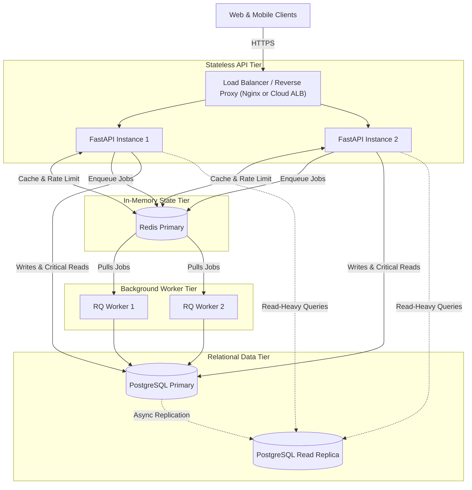

# TaskFlow Architecture Design: Scaling 100x

- **Status**: Proposal (Design Note)
- **Target**: Accommodate 100x user and data growth pragmatically
- **Guiding Principle**: Simplicity first. Measurement before optimization. No premature complexity.

---

## 1. Current Architecture & Known Bottlenecks

### Current State
- **Web Layer**: Single FastAPI application process (served via Uvicorn).
- **Data Layer**: Relational database (currently SQLite in development, target PostgreSQL in production) accessed via SQLAlchemy ORM.
- **Cache & Rate Limiting**: Single-node Redis instance used for:
  - Cache-Aside query caching (`project:{id}:summary` with 60s TTL).
  - Token Bucket rate limiting (30 requests/minute per client).
- **Background Tasks**: FastAPI in-process `BackgroundTasks` (executed in web server process memory) with an optional/demonstrated RQ worker architecture.

### Known Bottlenecks at Current Baseline
1. **Single Database Connection Pool**: A single database host with default pool sizes will bottleneck when concurrent write operations surge.
2. **In-Process Background Memory**: Background tasks running in-process consume web server memory and are lost if the web process restarts.
3. **Global Interpreter Lock (GIL) & Process Limits**: A single Uvicorn worker utilizes only 1 CPU core for Python execution.

---

## 2. What to Measure First (Observability Baseline)

Before adding infrastructure, instrument the following telemetry to establish a baseline:

1. **Request Latency (RED Method)**:
   - Measure P50, P95, and P99 latency grouped by endpoint.
   - Target: Reads ≤ 50ms, Writes ≤ 100ms.
2. **Database Query Latency**:
   - Log queries exceeding 50ms (`log_min_duration_statement` in PostgreSQL).
   - Use `EXPLAIN (ANALYZE, BUFFERS)` to track buffer hits and table scan percentages.
3. **Error Rates**:
   - Track HTTP 5xx (internal server / database connection failures) vs. HTTP 4xx (client validation, rate limits).
4. **Throughput (RPS)**:
   - Track Requests Per Second per route to identify the hottest endpoints (e.g., task listing vs. task creation).
5. **System Resource Saturation**:
   - **CPU & Memory**: Tracking CPU spikes during password hashing (bcrypt) or JSON serialization.
   - **Connection Pool Utilization**: Number of active vs. idle SQLAlchemy / PostgreSQL connections.

---

## 3. What Could Break First at 100x Growth

1. **#1: Database Connection Pool Exhaustion**:
   - PostgreSQL default `max_connections` (typically 100) will be overwhelmed by 100x concurrent clients, resulting in `FATAL: remaining connection slots are reserved`.
2. **#2: Unindexed Multi-Filter Query Scans**:
   - At 1,000,000 tasks, queries filtering by unindexed columns (e.g., status, priority, or user search) will perform full sequential table scans, spiking DB CPU to 100%.
3. **#3: Web Worker Thread / Event Loop Starvation**:
   - Synchronous blocking operations (e.g., database transactions or slow outbound network calls) inside worker processes will block the event loop, causing incoming requests to queue up and time out.
4. **#4: Cache Stampede (Dog-piling)**:
   - When a popular cached key (e.g., project summary) expires under high concurrency, dozens of requests simultaneously hit the database to recompute it.

---

## 4. Staged Improvement Plan (Priority Order)

| Stage | Focus Area | Action | Estimated Impact |
| :---: | :--- | :--- | :--- |
| **Stage 1** | **Database & Connection Pooling** | 1. Deploy **PgBouncer** in transaction pooling mode. 2. Add covering B-Tree composite indexes for all common filter combinations. | Eliminates connection starvation; query execution remains $\mathcal{O}(\log N)$. |
| **Stage 2** | **Asynchronous Worker Offloading** | Move all email/reminder jobs from FastAPI `BackgroundTasks` to **RQ (Redis Queue)** workers. | Prevents API latency degradation; guarantees job durability across restarts. |
| **Stage 3** | **Stateless Horizontal Web Scaling** | Run 2–4 FastAPI application instances behind a lightweight reverse proxy (**Nginx** or **AWS ALB**). | Utilizes all available server CPU cores; provides zero-downtime rolling deploys. |
| **Stage 4** | **Read Replication (If Needed)** | Configure 1 PostgreSQL **Read Replica** for heavy listing and reporting queries (`GET /api/v1/projects/{id}/summary`). | Isolates read traffic from primary write transactions. |

---

## 5. Where Scalability Patterns Help

- **Caching (Redis Cache-Aside)**: Absorbs 80–90% of repetitive dashboard summary reads. TTLs (60s) and targeted write invalidation keep data fresh without overloading the DB.
- **PostgreSQL Tuning & Indexes**: Composite indexes (e.g., `(project_id, status, priority)`) prevent table scans as tables grow to millions of rows.
- **Background Queues (RQ)**: Keeps HTTP response times fast (<30ms) by moving slow I/O out of the request/response cycle.
- **Rate Limiting (Token Bucket)**: Protects against scraping, accidental infinite loops in frontend clients, and brute-force abuse.
- **Horizontal Scaling & Load Balancing**: Enables linear scaling of stateless Python compute across CPU cores and machines.

---

## 6. Proposed Future Architecture (100x Target)

> [!NOTE]
> The diagram below represents a **proposed future evolution** to support 100x growth, NOT the current single-container system.

---

## 7. Failure Modes & Monitoring Strategy

| Failure Scenario | Mitigation Strategy | Detection / Alert |
| :--- | :--- | :--- |
| **Redis Outage** | Cache-Aside gracefully falls back to database queries; Rate Limiter falls back to local in-memory token bucket. | Alert on Redis `ping` failure; spike in DB query latency. |
| **Database Pool Exhaustion** | PgBouncer queues short-lived transaction connections; API returns `503 Service Unavailable` with `Retry-After` if queued too long. | Alert when pool utilization > 80%. |
| **Worker Queue Buildup** | Scale worker processes horizontally; dead-letter queue (DLQ) for repeated job failures. | Alert when RQ queue depth > 500 jobs or latency > 60s. |

---

## 8. What NOT to Add Yet & Why (Anti-Patterns)

1. **NO Kubernetes**:
   - *Why*: Adds massive operational overhead, complex networking, and YAML maintenance. 2–4 container instances managed via Docker Compose, AWS ECS, or Render can handle 100x traffic with a fraction of the complexity.
2. **NO Microservices**:
   - *Why*: Splitting TaskFlow into separate "User Service", "Task Service", and "Project Service" introduces network serialization overhead, distributed transaction failures, and cross-service latency. A **Modular Monolith** scales further and is far simpler to maintain.
3. **NO Database Sharding / NoSQL**:
   - *Why*: PostgreSQL with proper indexes and table partitioning easily handles tens of millions of rows. Sharding introduces complex query routing and breaks foreign key constraints prematurely.
4. **NO Apache Kafka**:
   - *Why*: Kafka requires dedicated brokers, partition management, and ZooKeeper/KRaft. Redis Queue (RQ) handles thousands of jobs per second with tools already in our stack.
