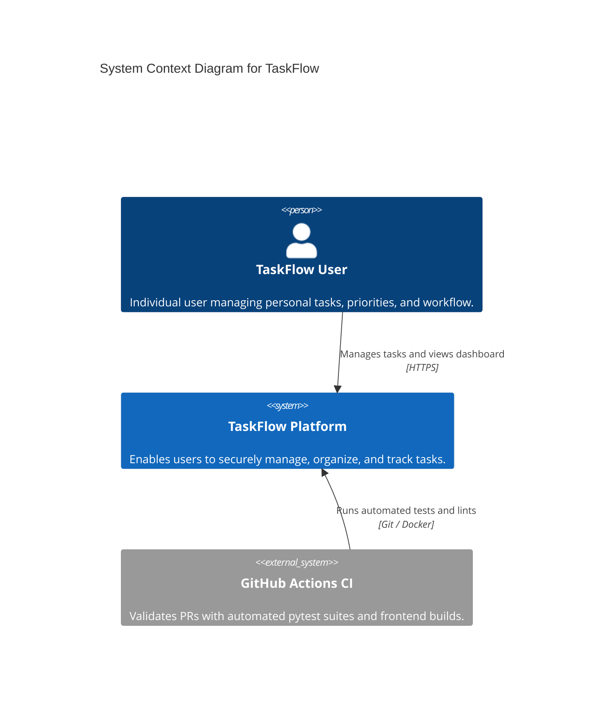
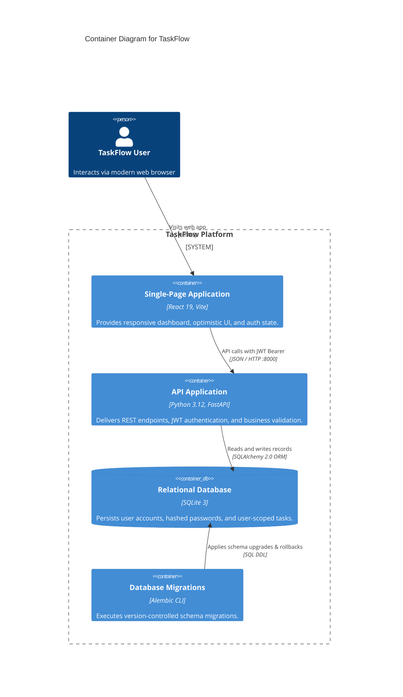

# Learning Log — Day 2: System Design Fundamentals & Architecture

- **Date**: 2026-10-22
- **Author**: Battineedi Charan
- **Milestone**: Day 2 — Requirements, REST API Contracts, C4 Diagrams & Modular Monolith ADR
- **Status**: Completed & Verified

---

## 1. Objectives & Goals
- [x] Inspect existing repository, architecture, API docs, ADRs, and learning logs without breaking existing work.
- [x] Master core system design concepts: Functional vs. Non-Functional Requirements, Latency vs. Throughput, Scalability, Availability, and Consistency.
- [x] Define measurable TaskFlow requirements and label planning assumptions explicitly.
- [x] Establish a production-grade REST API contract in `docs/api.md` with pagination envelopes and RFC 9457 Problem Details error schemas.
- [x] Create C4 Context (Level 1) and Container (Level 2) diagrams using Mermaid in `docs/architecture.md`.
- [x] Evaluate architectural patterns (Modular Monolith vs. Microservices) and record ADR 0003.
- [x] Review cross-document consistency without writing premature feature code.

---

## 2. Core Concepts Learned

### A. Functional vs. Non-Functional Requirements
- **Functional Requirements (FRs)**: Describe *what* the system does (e.g., user registration, task creation, filtering).
- **Non-Functional Requirements (NFRs)**: Define *how well* the system performs (e.g., latency, throughput, availability, security).
- **Explicit Assumptions**: When real telemetry does not yet exist, estimates must be explicitly labeled as planning assumptions (e.g., v1 target scale of ~1,000 users, 80% read / 20% write distribution).

### B. Latency vs. Throughput
- **Latency**: Duration of a single request from dispatch to response (measured in milliseconds).
  - *Analogy*: Time spent waiting for a barista to make your latte.
- **Throughput**: Number of operations processed per unit of time (measured in Requests Per Second — RPS).
  - *Analogy*: Number of coffees the cafe serves per hour.
- *Highway Rule*: Latency is the speed limit; throughput is the number of lanes.

### C. Scalability, Availability & Consistency
- **Scalability**: Handled vertically (beefier hardware) or horizontally (more stateless instances behind a load balancer).
- **Availability**: System uptime percentage ("nines"). TaskFlow v1 targets 99.5% uptime.
- **Consistency**: TaskFlow enforces Strong ACID consistency via relational transactions (SQLAlchemy + SQLite/PostgreSQL) so writes are instantly readable.

### D. Professional API Contracts (RFC 9457 & Pagination)
- **RFC 9457 (Problem Details)**: Standardized error structure (`type`, `title`, `status`, `detail`, `instance`) replacing inconsistent error payloads.
- **Envelope Pagination**: Returning `items`, `total`, `limit`, and `offset` ensures databases do not crash on massive table scans and gives frontend pagination state.

### E. The C4 Model
- **Level 1 (System Context)**: Zooms out to show human users, external systems (GitHub Actions CI), and the platform boundary.
- **Level 2 (Container)**: Zooms in to show deployable pieces (React 19 SPA, FastAPI backend, SQLite DB, Alembic CLI).

---

## 3. Decisions & Artifacts Produced

| Document | Purpose & Changes Applied |
| :--- | :--- |
| [`docs/architecture.md`](file:///c:/Users/91630/OneDrive/Desktop/taskflow/docs/architecture.md) | Added Section 2 with measurable FRs/NFRs and explicit assumptions; added Mermaid C4 Context & Container diagrams. |
| [`docs/api.md`](file:///c:/Users/91630/OneDrive/Desktop/taskflow/docs/api.md) | Fully drafted REST contract for auth and tasks, query parameters, pagination envelopes, and RFC 9457 error schemas. |
| [`docs/adr/0003-modular-monolith-architecture.md`](file:///c:/Users/91630/OneDrive/Desktop/taskflow/docs/adr/0003-modular-monolith-architecture.md) | Documented rationale for choosing a Modular Monolith over premature microservices. |
| [`docs/adr/README.md`](file:///c:/Users/91630/OneDrive/Desktop/taskflow/docs/adr/README.md) | Updated ADR index with ADR 0003. |

---

## 4. Architecture Diagrams

### 4.1 C4 Level 1: System Context Diagram

### 4.2 C4 Level 2: Container Diagram

---

## 5. Practical Sanity Drills & Key Learnings

1. **Out-of-Bounds Pagination Drill**:
   - *Question*: What happens if a client requests offset 50 on a table with 10 rows?
   - *Result*: The API returns `200 OK` with `"items": []`, `"total": 10`, `"limit": 20`, `"offset": 50`. It is **not** a 404 error because the resource collection exists.
2. **Contract Validation Drill**:
   - *Question*: How are schema errors presented?
   - *Result*: As HTTP `422 Unprocessable Content` conforming to RFC 9457 with detailed `invalid_params`.

---

## 6. Open Engineering Questions

1. **Database Migration Trigger**: At what point should TaskFlow switch from SQLite to PostgreSQL?
   - *Answer*: When concurrent writes create SQLite database lock contention, or when multiple backend worker processes need to scale horizontally across instances.
2. **Token Revocation Strategy**: How should immediate logout be handled if JWTs are stateless?
   - *Answer*: For v1, use 60-minute expiration with client-side token disposal. In future sprints, introduce a Redis-backed blocklist or refresh token rotation.

---

## 7. Next Steps (Day 3 Preview)
- Define SQLAlchemy `User` model and password hashing utility using `bcrypt`.
- Implement user registration, login, and `/api/v1/auth/me` endpoints.
- Generate and apply Alembic migrations for the users table.
- Write pytest suites for authentication flows.
